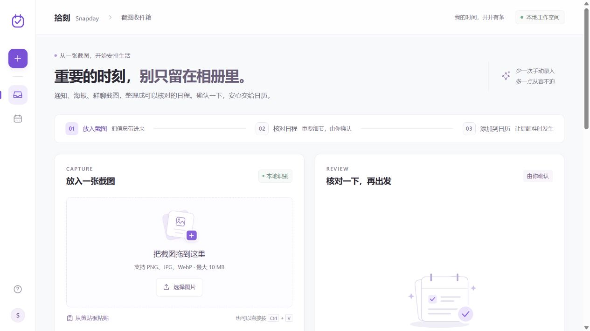
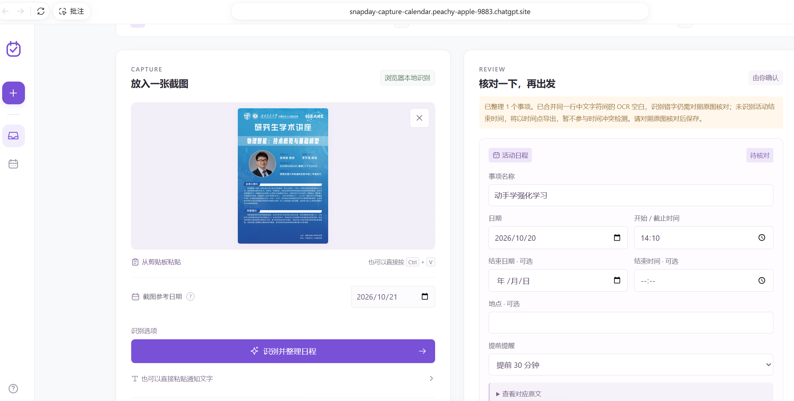
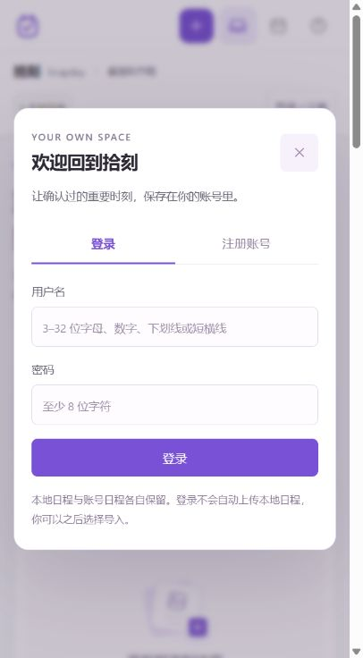

# 拾刻 Snapday · v2 全栈版

**把截图里的重要时刻，交给日历。**

Snapday 是一个面向活动通知、群聊截图和报名海报的个人日程工具。在浏览器内识别截图文字、整理活动与截止时间，核对后保存到时间线，再统一导出日历文件。v2 增加了账号系统、服务端日程存储和 REST API；仍可免登录使用本地体验。

**多项活动集中整理，减少重复录入。** 当课程、讲座、社团活动和报名通知较多时，可以逐张识别截图，把核对后的事项累计到同一条时间线，再一次性导入日历。实际节省时间取决于截图清晰度和人工修正量，尚未进行耗时对照测量。

## 界面展示

以下截图展示截图输入、人工核对、多事项管理和 v2 账号入口。

**1. 首页总览：截图输入与日程整理入口**



**2. 截图识别与人工核对**

上传活动海报后生成可编辑草稿，对照原图修正标题、日期与时间，并补充遗漏字段，再确认保存。



**3. 多项活动集中管理**

不同截图中的活动与报名截止事项累计到同一条时间线，支持查看、编辑和统一导出。


**4. v2 账号入口**

全栈服务提供注册与登录入口，支持将核对后的事项保存至账号。游客日程与账号日程分别保留，可按需导入。



## 功能

- **截图与文字输入**：选择、拖放或粘贴 PNG / JPG / WebP 图片，也支持粘贴通知文字。
- **本地识别与日期核对**：浏览器 OCR 提取文字，规则引擎整理一个主活动及一个可选截止事项；缺失或含糊字段由用户核对补充。
- **日程管理**：时间线、搜索、筛选、编辑、移除与撤销，以及重复提示和完整时段冲突检查。
- **账号与云端日程**：用户名注册、登录、退出；已登录事项保存在所连接后端的 SQLite 数据库，按账号隔离。
- **本地数据导入**：登录不会自动上传游客数据，可显式分批导入本地日程，跳过重复项并保留原本地记录。
- **日历导出**：游客模式在浏览器生成文件；账号模式由后端从该账号数据生成，支持单项与全部日程导出。
- **多设备访问**：不同设备连接同一个可访问的后端，登录同一账号后手动刷新日程，读取已保存的修改。

## 快速运行

需要 **Node.js 22.13 或更新版本，推荐 Node.js 24**。本仓库没有 npm 运行依赖，**无需 `npm install`**。

在项目目录运行：

```sh
npm start
```

打开 **http://127.0.0.1:4173**。服务同时提供前端页面与 `/api/` 接口，首次启动自动创建 `data/snapday.sqlite`，再次启动保留账号和日程。Windows 也可运行 `scripts/start-local.cmd`；终端按 `Ctrl+C` 停止服务。

只体验静态前端时：

```sh
npm run start:static
```

静态模式仍使用 http://127.0.0.1:4173，仅支持游客本地功能。两个启动命令不要同时占用同一端口。应用依赖 HTTP 服务加载 Worker、WASM 与 ES Modules，不支持双击 HTML 启动。

## 快速体验

1. 点击「摄影分享会」加载自制样例，再点击「识别并整理日程」执行 OCR。
2. 对照原图修正错字，核对活动时间、地点和报名截止。
3. 确认保存后继续处理其他截图，把多项活动汇总到时间线。
4. 在全栈服务中注册或登录，按需点击「导入本地日程」；本地与账号日程分别保留。
5. 点击「导出全部日程」，将 `.ics` 文件手动导入自己的日历软件。

第一次识别需要加载本站的字库和引擎。内置样例来自实际图片识别，选择样例不会预填结果；OCR 仍可能产生错字和遗漏。

## 数据如何保存

| 模式 | 保存位置 | 其他设备如何访问 |
| --- | --- | --- |
| 游客本地体验 | 当前浏览器的 localStorage | 不自动跨设备；清理网站数据会移除记录 |
| 登录账号 | 当前后端的 SQLite 数据库 | 连接同一后端并登录同一账号，手动刷新日程 |

原始图片始终在浏览器中识别，不上传到后端。**账号模式保存的日程字段、备注和原文依据会发送到后端并存入数据库。** 本地数据只有在显式导入时才上传；退出账号恢复游客时间线，不删除已有账号日程。

导入按批次提交。单个批次使用数据库事务；若中途失败，已成功的批次可能保留。界面显示已确认进度，刷新后可重试，重复事项会跳过。

## 技术架构

```text
截图 / 通知文字
    → 浏览器 Tesseract.js OCR
    → 日期解析 + 可编辑草稿 + 人工确认
    ├─ 游客：localStorage → 浏览器生成 .ics
    └─ 账号：同源 REST API → SQLite → 后端生成 .ics
```

| 层次 | 实现 |
| --- | --- |
| 前端 | HTML、CSS、JavaScript ES Modules、Web Worker、WASM |
| OCR | Tesseract.js 6.0.1，中英字库同源自托管 |
| API | Fetch Request / Response 接口，Node 内置 HTTP 服务承载 |
| 存储 | Node 内置 SQLite，参数化查询、外键约束、事务、按用户隔离 |
| 认证 | 随机盐 PBKDF2-SHA256 密码哈希、Cookie 会话、数据库保存会话令牌摘要 |
| 一致性 | 账号一致性检查、事项版本校验、重复约束、分批事务导入 |
| 日历 | RFC 5545、上海时间转 UTC、稳定 UID、UTF-8 折行、可选 VALARM |
| 部署 | Node / Docker；静态游客前端可单独部署到 GitHub Pages |

**本项目使用 AI 编程工具辅助开发，运行时不调用通用大语言模型 API。** 本地 OCR 与日期规则不需要模型 API 密钥。架构与数据规则见 [项目说明](docs/PROJECT.md)，接口见 [API 文档](docs/API.md)。

## 测试与验证

```sh
npm test
npm run check
npm run build
```

当前自动化测试 **37/37 通过**，覆盖日期与日历引擎、静态资源路径、账号会话、用户数据隔离、输入校验、版本冲突、导入和 HTTP 持久化等场景，语法与资源检查也已通过。GitHub Actions 在提交和拉取请求时运行检查。

已在真实浏览器中验证注册、账号日程保存与刷新恢复，以及退出后恢复原游客日程；登录未自动上传游客数据。

实际通过结果、浏览器验证及待测范围统一记录在 [验收记录](docs/QA.md)。少量合成样例不代表通用 OCR 准确率，也未替代真实用户研究。

## 适用范围

- 每张图提取一个主活动及一个可选截止事项；暂不覆盖复杂课表、多活动长图或重复日程。
- 输入按中国标准时间（UTC+08:00）解释；所有草稿需要人工确认。没有结束时间的活动不参与精确时段冲突检查。
- 账号使用用户名与密码，没有邮箱验证、密码找回或第三方登录。
- 多设备数据依赖同一个后端。当前没有实时推送、自动刷新或离线云端写入队列。
- `.ics` 是导出快照，网页后续修改不会自动同步到系统日历；提醒由导入的日历软件执行。
- 静态托管只提供游客体验，不能运行账号服务或数据库。全栈部署需持久化数据库并正确配置 HTTPS 来源。

## 项目结构

```text
dist/
  app.mjs                OCR、账号模式、草稿与时间线
  lib/engine.mjs         日期、校验、冲突及日历序列化
  lib/api-client.mjs     同源 API 客户端
  assets/                自制样例海报
  vendor/                OCR 引擎、WASM、字库及许可证
server/
  node.mjs               HTTP 与静态资源入口
  api.mjs                Fetch REST API 与认证逻辑
  sqlite.mjs             SQLite / D1 形状接口适配
  schema.sql             用户、会话、日程与限流表
data/                    本地数据库，不提交版本控制
scripts/                 静态开发服务和资源检查
tests/                   自动化测试
docs/                    项目、API、部署及验收记录
Dockerfile               Node 全栈部署镜像
.github/workflows/       自动检查与手动静态 Pages 发布
```

## 部署

完整账号功能使用 Node 或 Docker 部署，详见 [部署说明](docs/DEPLOY.md)。GitHub Pages 仅部署 `dist/`，保留截图识别与本地游客体验，不提供账号或服务端存储。

API 使用 D1 形状的数据库接口，便于复用到其他运行时；这不代表已有公开可用的 D1 云端实例。当前运行入口和部署说明以本仓库的 Node / SQLite 服务为准。

## 第三方归属

OCR 引擎、WASM 和语言数据来自 [Tesseract.js](https://github.com/naptha/tesseract.js)、[Tesseract.js Core](https://github.com/naptha/tesseract.js-core) 和 [Tesseract.js Data](https://github.com/naptha/tessdata)。第三方许可与来源见 [dist/vendor/THIRD-PARTY.md](dist/vendor/THIRD-PARTY.md)。内置样例海报为项目自制，标注为非真实活动。
